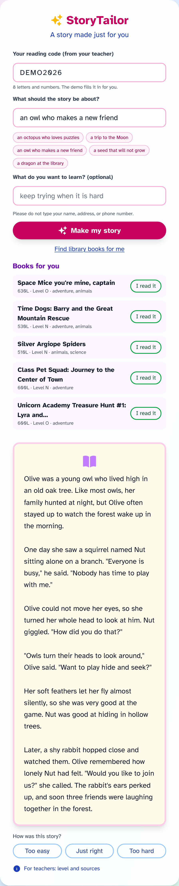
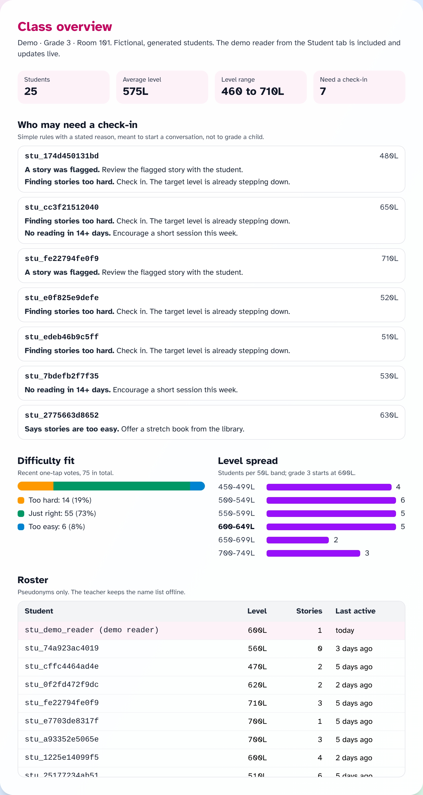
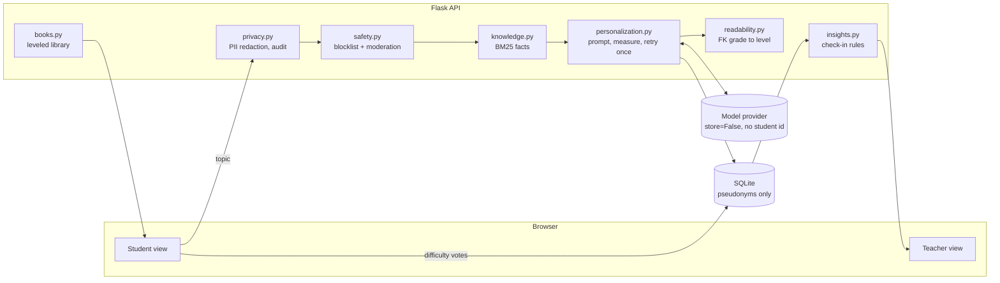

# StoryTailor

[](https://github.com/deokhwajeong/storytailor.ai/actions/workflows/ci.yml)
[](https://deokhwajeong.github.io/demos/storytailor/)
[](LICENSE)

**A personalized reading platform for elementary classrooms.** Students get short,
original stories pitched at their own reading level and built around what they
care about. Teachers see how the class is responding. Student data stays
minimal, pseudonymous, and under the school's control.

Python · Flask · OpenAI API · SQLite · React + Vite

<p align="center">
  
  
</p>

<p align="center"><sub>Student and teacher views from the static demo: sample stories and a fictional, seeded class.</sub></p>

## Live demo

**[Try it in your browser](https://deokhwajeong.github.io/demos/storytailor/)**: the real
student UI and a teacher view, with no server and no API key. In the demo build, API calls are answered by an
in-browser mock (`frontend/frontend/src/demo/`) that mirrors the server logic: PII
redaction and the topic safety check, picking the story draft closest to the reader's
target level, the feedback rule that moves the target by 50L, and leveled recommendations
from the real classroom catalog. Stories are pre-written samples, three leveled drafts per
topic, measured with the same readability formula the server uses. The reader is a
fictional grade 3 student, and nothing is sent or stored; reloading resets the demo.

The **Teacher** tab shows a fictional, seeded grade 3 class (pseudonyms only) with the demo
reader included: level spread, difficulty fit, a roster, and "who may need a check-in"
computed by a port of `storytailor/insights.py`. Vote "too hard" twice in the Student tab
and the reader shows up there with the reason. The font is bundled with the build, so the
page makes no third-party requests (CI checks the build for external URLs).

```bash
cd frontend/frontend && npm install && npm run build:demo   # static site in dist-demo/
npm run dev:demo                                            # same mock, with hot reload
```

## Background

StoryTailor grew out of a 2026 pilot with one elementary classroom.
Through weekly volunteer visits, the
classroom's book list was collected and cataloged (148 titles with Lexile and
guided reading levels), a digital library search was built for the class,
and students' reading was checked in person each week.

That experience shaped three priorities:

1. **Fit the reader.** A story or book is only useful if a child can read it.
   Every generated story is measured after generation and regenerated if it
   misses the target, and library books are recommended within the reader's band.
2. **Close the loop.** One tap ("too easy / just right / too hard") from a
   student, or a flag from a teacher, changes the next story.
3. **Treat student data as the school's.** No names, no ads, export and
   delete on request, retention by default. See [docs/PRIVACY.md](docs/PRIVACY.md).

No student data from the pilot is included in this repository. The demo
classrooms described below are synthetic and are not pilot results.

## How it works



Request path for one story, step by step:

```
 student types a topic
          |
          v
  PII redaction  ---->  audit log (kinds removed, never values)
          |
          v
  safety check (topic) ---- blocked? -> friendly 422
          |
          v
  retrieve grounding facts (BM25 over curated knowledge base)
          |
          v
  prompt = grade + target level + interests + avoid-topics + facts
          |
          v
  OpenAI chat completion (store=False, no student identifier)
          |
          v
  soften wording -> measure readability -> too hard? regenerate once with SIMPLIFY
          |
          v
  safety check (story + moderation API) -> save -> return story with sources
          |
          v
  student / teacher feedback -> adjust target level, add avoid-topics
          |
          v
  teacher dashboard: difficulty fit, ratings, flagged stories, level spread, reading minutes
```

### Classroom library

Alongside generated stories, students get **real books from the classroom
library**. The catalog (`storytailor/data/books.json`, 148 titles) comes from
the book list a classroom kept for its digital library search page: title,
Lexile, and guided reading letter level, deduplicated from 155 rows.

- **Recommendations** use the reader's band of 100L below to 50L above their
  target level, rank by interest overlap and closeness to target, skip books
  already read, and widen the band when few books are left at that level.
- **Search** filters by title, letter level, and Lexile range, and falls back
  to fuzzy matching (Levenshtein over title windows) because kids misspell:
  `matlida` finds *Matilda*, `wimpy kidd` finds *Diary of a Wimpy Kid*.
- **Reading log**: "I read it" records the book, feeds the teacher summary,
  and removes it from future recommendations.

Lexile and letter levels are kept as recorded in the classroom list and have
not been re-verified. Topic tags are keyword guesses from titles.

| Module | Responsibility |
|---|---|
| `storytailor/personalization.py` | Prompt building, level-fit retry loop, feedback-driven level adjustment |
| `storytailor/privacy.py` | PII redaction, pseudonyms, keyed hashing, export, delete, retention purge, audit |
| `storytailor/knowledge.py` | BM25 retrieval over `data/knowledge.json` so real-world facts in stories are grounded |
| `storytailor/books.py` | Classroom library catalog, leveled recommendations, fuzzy title search |
| `storytailor/insights.py` | Teacher check-in rules: each flag carries a plain reason code |
| `storytailor/demo.py` | Synthetic demo classrooms (generator, and importer that only accepts files marked synthetic) |
| `storytailor/readability.py` | Flesch-Kincaid grade mapped to an approximate Lexile-style band |
| `storytailor/safety.py` | Word-boundary blocklist and wording softener (plus provider moderation) |
| `storytailor/llm.py` | OpenAI provider and an offline deterministic provider for demos and zero-egress use |
| `storytailor/routes/` | Flask blueprints: classroom, stories, privacy, public utilities |
| `frontend/frontend/` | Student and teacher views (React + TypeScript + Tailwind) |

## Quick start

```bash
python -m venv .venv && source .venv/bin/activate
pip install -r requirements.txt
cp .env.example .env            # add OPENAI_API_KEY, or set STORYTAILOR_LLM_PROVIDER=offline

flask --app storytailor init-db
flask --app storytailor create-teacher "Room 12"     # prints a teacher token once
flask --app storytailor run
```

```bash
TOKEN=...   # from create-teacher

# Teacher: create a class and 25 pseudonymous student accounts
curl -X POST localhost:5000/api/classrooms -H "Authorization: Bearer $TOKEN" \
     -H 'Content-Type: application/json' -d '{"name": "Grade 3", "grade": 3}'
curl -X POST localhost:5000/api/classrooms/1/students -H "Authorization: Bearer $TOKEN" \
     -H 'Content-Type: application/json' -d '{"count": 25, "interests": ["ocean", "space"]}'

# Student: ask for a story with the access code from the printed roster
curl -X POST localhost:5000/api/stories -H "X-Student-Code: K7QM3XPA" \
     -H 'Content-Type: application/json' -d '{"topic": "an octopus who loves puzzles", "learning_goal": "keep trying"}'
```

Try it with demo classrooms (synthetic, labeled "Demo"):

```bash
flask --app storytailor seed-demo        # 8 classrooms, grades 2-5, 200 fictional pseudonymous students
# or: flask --app storytailor seed-demo --from-file path/to/synthetic_dataset.json
# prints a demo teacher token; student codes go to instance/demo_access_codes.csv
```

See [docs/DEMO_DATA.md](docs/DEMO_DATA.md).

Front end:

```bash
cd frontend/frontend && npm install && npm run dev
```

## API

| Method | Path | Who | Purpose |
|---|---|---|---|
| POST | `/api/classrooms` | teacher | Create a classroom |
| POST | `/api/classrooms/<id>/students` | teacher | Create pseudonymous accounts; access codes returned once |
| GET | `/api/classrooms/<id>/students` | teacher | Roster by pseudonym, level, activity |
| GET | `/api/classrooms/<id>/feedback-summary` | teacher | Difficulty fit, ratings, flags, level spread, who may need a check-in |
| POST | `/api/stories` | student | Generate a personalized, grounded, leveled story |
| GET | `/api/stories` | student | My recent stories |
| POST | `/api/stories/<id>/feedback` | student | Rating, difficulty vote, or flag |
| POST | `/api/stories/<id>/teacher-feedback` | teacher | Teacher review of a student's story |
| GET | `/api/students/<id>/export` | teacher | Everything stored about a student (records request) |
| DELETE | `/api/students/<id>` | teacher | Hard delete |
| POST | `/api/students/<id>/consent` | teacher | `school_authorized` / `pending` / `withdrawn` |
| GET | `/api/students/<id>/audit` | teacher | Access history for a student record |
| GET | `/api/books/recommendations` | student | Library books in my band, matched to my interests |
| POST | `/api/books/log` | student | Record a book I read |
| GET | `/api/books/search?q=&level=&min_lexile=&max_lexile=` | anyone | Library search with fuzzy fallback |
| POST | `/api/readability` | anyone | Estimate the level of a passage (not stored) |
| GET | `/api/knowledge/search?q=` | anyone | Inspect grounding facts |

## Tests

```bash
pytest -q
```

The suite runs fully offline. It covers the level-fit retry, feedback-driven
level changes, the readability formula and its grade-to-level mapping, library
recommendations and fuzzy search, PII redaction for each kind a child might type
(and that nothing identifying reaches the model prompt, storage, or audit log),
the teacher check-in rules, cross-teacher access isolation, export, delete,
consent withdrawal, retention purge, that the demo importer rejects files not
marked synthetic, and parity between the server and the static demo.

CI runs `ruff check`, `pytest`, ESLint, the TypeScript build, the demo build,
and a check that the demo bundle references no external URLs.

## Design decisions

- **Why Flask and SQLite.** A school pilot needs something a single volunteer
  can deploy and a district IT reviewer can read end to end. One process, one
  file database the district owns, no external services besides the model API.
- **Why BM25 instead of a vector DB.** The grounding corpus is small and
  curated by hand for accuracy. Lexical retrieval is transparent, testable,
  and runs offline. Swapping in embeddings is a contained change in `knowledge.py`.
- **Why measure after generating.** Asking a model for "grade 2 vocabulary"
  is not reliable on its own. Measuring the output and retrying once with a
  simplification instruction keeps stories near the target without a long loop.
- **Explainable check-ins, not risk scores.** `insights.py` flags a student
  only for a concrete reason a teacher can act on (a flagged story, a run of
  "too hard" votes, a level well below the grade start, 14+ days without
  reading, or "too easy" votes) and returns the reason with the flag. No
  composite score, no ranking of children.
- **Pseudonyms end to end.** The database never holds names; the teacher
  keeps the pseudonym-to-name roster offline. The teacher view shows the
  same pseudonyms, so the dashboard adds no new identifying data.
- **A static demo that cannot drift silently.** The demo re-implements a few
  server rules in TypeScript so it needs no backend. `tests/test_demo_parity.py`
  reads that TypeScript and fails if the constants, blocklist, PII pattern
  order, or sample story measurements stop matching the Python.
- **Reading levels are approximate.** The Lexile-style number is mapped from
  Flesch-Kincaid grade and is meant for relative adjustment, not as an
  official Lexile measure.

## Roadmap

- Read-aloud (TTS) and fluency practice with on-device speech recognition
- Teacher actions from the dashboard (review flagged stories, adjust a level)
- Spanish and Korean story output for multilingual classrooms
- Teacher-editable knowledge base with review workflow

## License

MIT. See [LICENSE](LICENSE).
